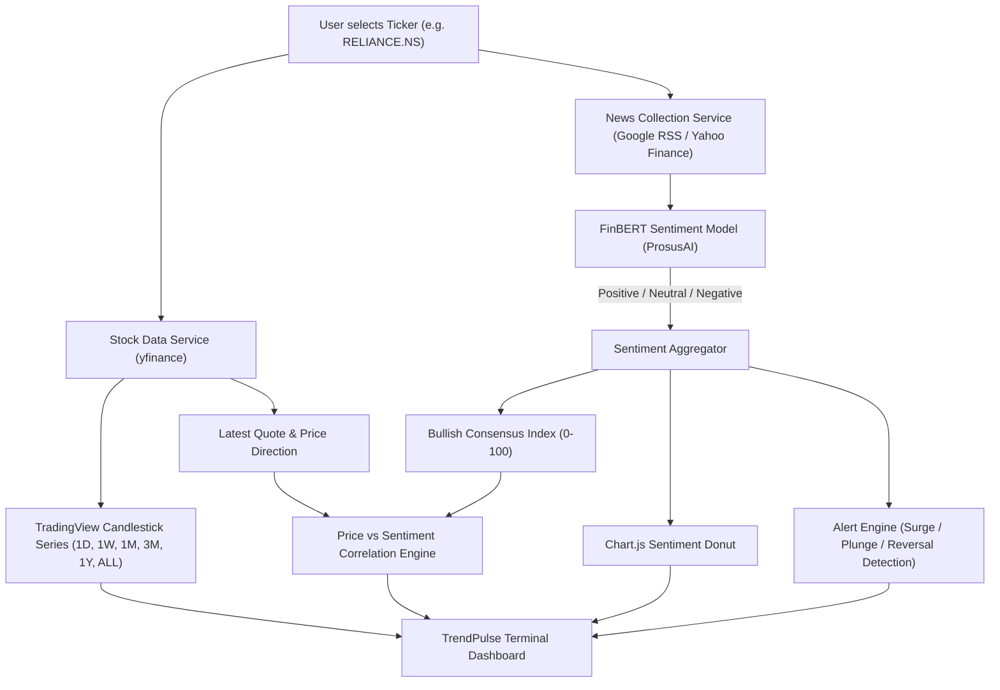

# TrendPulse AI — AI-Based Stock Market Sentiment Tracker


**TrendPulse AI** is a financial intelligence and sentiment analytics platform that connects public market information, real-time news coverage, and stock price movements. Designed for Indian equities (NSE/BSE) and global markets (US / S&P 500), TrendPulse applies finance-specific Natural Language Processing (**FinBERT**) to classify news sentiment, compute aggregate consensus scores, visualize interactive candlestick charts, and alert users to significant sentiment shifts.

---

## 1. Core Problem Statement & Objectives

Financial markets react swiftly to narratives, disclosures, and press coverage. However:
- Retail and institutional investors are inundated with noise, duplicates, and sensationalized headlines.
- Generic NLP sentiment tools fail to grasp financial context (e.g., words like *"liability"*, *"headwind"*, *"drag"*, or *"dilution"*).
- Disparate sources make it difficult to compare news sentiment directly against historical price action.

### Key Objectives Implemented:
1. **Live Financial News Ingestion**: Automatically collects fresh financial news for any tracked company via authenticated feeds and Google News RSS.
2. **Company & Ticker Entity Matching**: Maps relevant companies to stock symbols (`RELIANCE.NS`, `TCS.NS`, `AAPL`, `NVDA`, etc.).
3. **Finance-Specific AI Sentiment Analysis**: Classifies news into Positive, Neutral, and Negative classes using **ProsusAI/FinBERT** with softmax probabilities and confidence metrics.
4. **Company-Level Sentiment Aggregation**: Synthesizes coverage into an aggregate **Bullish Consensus Index (0–100)** and net compound polarity (-1.0 to +1.0).
5. **Interactive Financial Charting**: Integrates **TradingView Lightweight Charts** with responsive multi-timeframe OHLCV candles (`1D`, `1W`, `1M`, `3M`, `1Y`, `ALL`).
6. **Sentiment vs Price Trend Alignment**: Directly computes and displays whether market price movements correlate with or diverge from current news sentiment.
7. **Explainable Sentiment Alerts**: Emits in-app alerts upon detecting bullish surges, bearish plunges, or rapid reversals across significant news volume.
8. **Multi-Company Comparison Matrix**: Allows side-by-side analysis of peer stocks on price changes, sentiment distribution, and news volume.

---

## 2. Technology Stack

### Frontend (Zero Framework Build Step)
- **HTML5 & CSS3**
- **Vanilla JavaScript (ES6+)**: Modular state management, dynamic DOM rendering, and API polling.
- **Tailwind CSS**: Dark-themed financial analytics terminal styling.
- **TradingView Lightweight Charts (v4.1.1)**: High-performance interactive candlestick & area financial charts.
- **Chart.js (v4.4)**: Sentiment distribution donut charts.
- **Phosphor Icons**: Terminal-grade financial UI iconography.

### Backend
- **Python 3.13**
- **Django 6.1**
- **Django REST Framework (DRF)**: Clean, documented JSON REST API architecture.

### AI & Data Engineering
- **Hugging Face Transformers (v5.19)**
- **ProsusAI/finbert**: Pretrained BERT model tailored for financial sentiment analysis.
- **Loughran-McDonald Financial Lexicon Fallback**: High-speed, transparent rule-based analyzer when offline or under constrained compute.
- **yfinance (v1.7) & Pandas**: Real-time market quotes, OHLCV historical time series, and market indices (`^NSEI`, `^BSESN`, `^GSPC`).
- **Google News RSS Parser**: Authentic, real-time financial news collection.

### Database
- **SQLite3**: Lightweight, zero-config relational database for local MVP deployment.

---

## 3. Architecture & Project Structure

```text
hackathon/
│
├── manage.py                          # Django execution entry point
├── .env.example                       # Environment configuration template
├── .gitignore                         # Strict exclusion rules (secrets, db, caches)
├── README.md                          # Comprehensive project documentation
│
├── trendpulse_project/                # Project Settings & Root Router
│   ├── __init__.py
│   ├── settings.py                    # App configuration, security, template dirs
│   ├── urls.py                        # Root URL router
│   ├── wsgi.py
│   └── asgi.py
│
├── tracker/                           # Core Sentiment & Financial App
│   ├── __init__.py
│   ├── models.py                      # TrackedStock, FinancialNews, SentimentAlert
│   ├── views.py                       # Dashboard view & REST API endpoints
│   ├── urls.py                        # Application route definitions
│   ├── sentiment_engine.py            # FinBERT inference & Lexicon fallback
│   ├── stock_service.py               # yfinance quotes & OHLCV formatting
│   ├── news_service.py                # Authentic news collection & DB persistence
│   ├── alert_engine.py                # Explainable alert detection algorithms
│   ├── admin.py                       # Django Admin configuration
│   └── tests.py                       # 19 comprehensive unit & integration tests
│
├── templates/
│   └── tracker/
│       └── index.html                 # Main responsive dashboard interface
│
└── static/
    ├── css/
    │   └── styles.css                 # Custom financial terminal theme
    └── js/
        └── dashboard.js               # Frontend controller & charting logic
```

---

## 4. API Endpoints Reference

| Method | Endpoint | Description |
|---|---|---|
| `GET` | `/` | Main interactive dashboard interface |
| `GET` | `/api/market-overview/` | Real-time quotes for NIFTY 50, SENSEX, and S&P 500 |
| `GET` | `/api/stock/<ticker>/` | Detailed quote, price change, day high/low, 52W range |
| `GET` | `/api/stock/<ticker>/history/?range=1M` | OHLCV candles formatted for TradingView charts |
| `GET` | `/api/stock/<ticker>/news/?limit=10` | Real-time news tagged with FinBERT sentiment & confidence |
| `GET` | `/api/stock/<ticker>/sentiment-summary/` | Aggregate Bullish index, distribution, and price correlation |
| `GET` | `/api/compare/?tickers=...` | Multi-company peer matrix comparison |
| `GET` | `/api/alerts/?limit=10` | In-app explainable sentiment shift alerts |
| `GET` | `/api/search/?q=<query>` | Instant stock and ticker autocomplete suggestions |
| `GET/POST`| `/api/watchlist/` | View and toggle tracked stocks in the user watchlist |

---

## 5. Quickstart Setup Instructions

### Prerequisites
- Python 3.10+ (Tested on Python 3.13)
- Git

### 1. Clone or Open the Repository
```bash
git clone <YOUR_REPOSITORY_URL>
cd hackathon
```

### 2. Configure Environment Variables
Copy the template configuration file:
```bash
cp .env.example .env
```
*(Optionally edit `.env` to specify custom secret keys or API keys if available).*

### 3. Install Dependencies
```bash
pip install django djangorestframework yfinance pandas requests transformers torch
```

### 4. Run Database Migrations
```bash
python manage.py makemigrations tracker
python manage.py migrate
```

### 5. Run the Automated Test Suite
Verify that all 19 unit and integration tests pass:
```bash
python manage.py test tracker
```

### 6. Start the Development Server
```bash
python manage.py runserver 127.0.0.1:8000
```
Open your browser and navigate to:
**`http://127.0.0.1:8000/`**

---

## 6. How Data & Sentiment Analysis Works



### Transparent AI Fallback Architecture
- **Primary Engine**: Hugging Face `ProsusAI/finbert` pipeline using PyTorch. Returns 3-class softmax probabilities (`positive`, `neutral`, `negative`).
- **Secondary Engine**: Loughran-McDonald Financial Lexicon. Employs finance-specific polarity heuristics if the neural model is offline or uninstalled.
- **Model Transparency**: The interface explicitly displays which model analyzed each article and includes clear disclaimer badges.

---

## 7. Known Limitations & Disclaimers

1. **Market Data Timing**: Market indices and quotes are fetched via yfinance and may be subject to standard 15-minute exchange delays when markets are actively trading.
2. **Sentiment vs Direction**: Linguistic sentiment in financial reporting reflects historical and immediate perception; it **does not** constitute financial advice or guarantee future stock price trajectories.
3. **News Coverage Availability**: Stocks with low trading volume or niche microcaps may have fewer recent news articles available in public RSS feeds.

---

## 8. License & Acknowledgments
Built for hackathon demonstration. FinBERT is provided by ProsusAI under Apache-2.0. Market data courtesy of Yahoo Finance API and Google News RSS.
